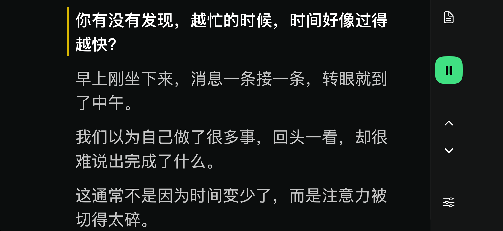

# 智能提词器

**一个跟着你说话走的中文提词器。**

口播时，最打断节奏的事之一，就是你还没说完，稿子已经滚走了；或者你已经说完，却还得等下一句。

我给自己做了这个小工具：把稿件放进去，它会听你正在说什么，找到对应的位置。快念完一句时，提前把下一句亮出来，让眼睛先接上，嘴巴继续把句尾说完。



## 用起来是什么感觉？

- **按你的节奏来。** 不是设置一个固定速度一直滚，而是根据实际朗读跟随。
- **下一句提前准备好。** 在识别到句尾位置后提前提示，减少念完一句还要等画面的停顿。
- **允许临时发挥。** 中间插几句自己的话，画面先保留位置；说回稿件后，再尝试找到你的位置。
- **当前句醒目，后文也能看清。** 字号、左右留白都能调，配合提词器反射镜时可以开启镜像。
- **手机横着放也好用。** iPhone横屏把按钮收在右侧，正文用满高度；竖屏和iPad也有各自的布局。

编辑稿件时，还会显示字数和预计朗读时长，方便判断这一段大概要讲多久。

## 你可以选两种方式

### 想自己做一个类似的

复制[这段提示词](docs/RECREATE_PROMPT.md)，交给能创建工程、运行代码的AI编程工具。不用下载这个项目，也不需要拿到我的聊天记录；它描述的是要做什么、怎么跟随、界面怎么摆。

不同AI、设备和实现会有差异，可以先做一个相近版本，再按自己的口播习惯调整。

### 想用我已经调过的版本

你可以先看这个仓库的代码和界面，再让AI或开发者按[安装与开发文档](docs/DEVELOPMENT.md)帮你构建。

**目前提供的是源码，不是App Store下载。** 自行安装需要Mac、Xcode、自己的Apple账号，以及支持本地中文识别的iPhone/iPad。首次使用可能需要下载系统语音模型。

装好后的使用步骤：

1. 打开稿件编辑，输入或粘贴你的口播稿。
2. 把手机横过来，调整字号、边距；需要反射时打开镜像。
3. 点开始，允许麦克风访问，然后正常朗读。绿色表示跟随已开启，黄色表示已暂停。

## 先说清楚几个边界

它是我实际口播中逐步调整的小工具，还不是所有场景都打磨完的产品。环境噪声、相似句子、临时大幅改写和系统识别延迟，都可能影响跟随；你也可以用上下句按钮手动调整。

- 语音识别在设备本机进行，应用没有接入第三方云识别服务，不保存录音文件。
- **稿件暂不自动保存**，关闭或重启后可能丢失，请保留原稿；字号、边距和镜像设置会记住。
- 预计时长按每分钟250字粗估，不是测量你的个人语速。
- 免费Apple开发签名有有效期，到期需要重新构建安装，具体见开发文档。

## 给想修改它的人

项目采用Swift和SwiftUI，运行下限为iOS/iPadOS 26。iPhone与iPad界面独立，复用同一套识别和跟随逻辑。

```sh
bash scripts/generate-ios-project.sh
open SmartTeleprompterProbe-iPadProject.xcodeproj
```

在Xcode中设置自己的Bundle ID、签名Team和目标设备。工程名里的iPad是历史命名，实际支持iPhone和iPad。

验证改动：

```sh
swift run --disable-sandbox TeleprompterChecks
bash scripts/check-boundaries.sh
```

- [开发文档](docs/DEVELOPMENT.md)：环境、安装、跟随原理、界面参数和验收场景。
- [复刻提示词](docs/RECREATE_PROMPT.md)：不依赖源码，自己做一个相近版本。

遇到问题可以提Issue，写清楚设备、系统版本、操作步骤，以及“预期怎样、实际怎样”。有可公开的小段样稿更容易复现；不要上传私人口播内容或录音。
