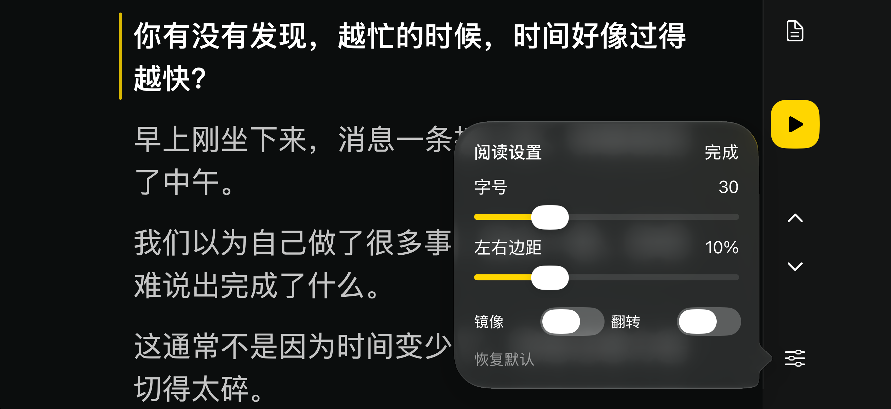

# 智能提词器开发文档

版本基线：2026-10-30。本文面向第一次接触项目的人，描述当前实现，不依赖作者聊天记录。要复用作者版本，以仓库源码、本文及测试为准；只想从零做近似版本，使用[独立复刻提示词](RECREATE_PROMPT.md)。

## 1. 产品目标与范围

用户粘贴中文口播稿，点开始，在设备本机识别讲话并定位原稿。当前句清晰突出，后文保持可读；读到句尾最后几个字时，提前提示下一句。脱稿时不乱走，回到稿件后重新定位，支持跳读和重读。

“智能”的核心是把识别事件、稿件定位和阅读提示协调起来。本实现使用文字和拼音相似度，不是大语言模型语义理解；不能保证任意改写、噪声、口音、极短重复句都准确，也不能消除Apple识别器自身的延迟。

当前含独立iPhone界面、iPad界面和Mac调试入口。无后端、登录、第三方识别API、应用内音频上传或录音文件。系统语音资源首次准备可能需要联网。稿件仅在运行内存中，退出或重启可能丢失；字号、边距和镜像偏好持久化。暂不提供稿件库、自动保存、云同步、导入文件或成品App下载。

## 2. 环境、构建与安装

### 环境

- Mac及完整Xcode；项目Swift语言模式6，iOS/iPadOS和Mac调试运行下限均为26.0。
- 本次实际构建环境为Xcode 27.1、XcodeGen 2.46.0；不是对其他工具版本的兼容性保证。
- 真机必须支持SpeechTranscriber及所选中文模型。仅系统版本足够不代表设备必然支持；运行时检查`isAvailable`和`supportedLocale(equivalentTo:)`。[Apple SpeechTranscriber文档](https://developer.apple.com/documentation/speech/speechtranscriber)
- 模拟器使用Fake引擎验证界面和事件流，不用它证明真实麦克风识别成功。

### 从仓库生成工程

获取仓库到本机后，在仓库根目录执行：

```sh
bash scripts/generate-ios-project.sh
open SmartTeleprompterProbe-iPadProject.xcodeproj
```

需要先安装XcodeGen。脚本从自身位置解析路径，向project.yml传入`TELEPROMPTER_PACKAGE_ROOT`；不要复制作者电脑上的绝对路径。工程由project.yml生成，生成产物被.gitignore排除。Apps/iPad/Info.plist作为INFOPLIST_FILE处理，必须在sources资源复制中排除，避免重复生成Info.plist。工程和scheme名中的iPad是历史命名，实际`TARGETED_DEVICE_FAMILY`为`1,2`，同时支持手机和平板。

1. 在project.yml将`PRODUCT_BUNDLE_IDENTIFIER`改为自己的唯一标识，例如`com.yourname.smartprompter`，再生成工程。
2. 在Xcode选择应用target → Signing & Capabilities，启用自动签名，选择自己的Team。
3. 连接自己的iPhone/iPad，解锁并信任电脑；启用设置中的开发者模式，按系统要求重启确认。
4. 在Xcode顶部选择该设备，运行。首次可能还需在“通用 → VPN与设备管理”信任/验证自己的开发者。
5. 打开App，添加稿件，点开始；允许麦克风，等待系统中文模型准备。

不需要作者证书、账号、设备标识或已签名安装包。重新生成工程可能覆盖在Xcode里手改的设置；Bundle ID等稳定配置写回project.yml，Team由各自本机配置。

免费Personal Team签名的描述文件从签发起7天到期，不发布App也不免除该限制。到期需由自己的开发环境重新构建安装；其他分发方式需按对应Apple规则配置。[Apple开发者账号说明](https://developer.apple.com/help/account/basics/about-your-developer-account)

### 检查命令

```sh
swift run --disable-sandbox TeleprompterChecks
bash scripts/check-boundaries.sh
```

当前测试入口是可执行检查程序，不是`swift test`。无签名模拟器构建可运行：

```sh
bash scripts/build-ipad-simulator.sh
```

脚本生成临时工程并构建通用iOS模拟器应用，不会自动向真机安装。设备签名和真实口播必须另行验证。

## 3. 架构与数据路径

```text
麦克风 → 音频复制/转换/采样时间轴 → SpeechAnalyzer/SpeechTranscriber
       → RecognitionEvent → TranscriptAccumulator → ScriptMatcher
       → ProbeViewModel → iPhone PhonePrompterView / iPad ProbeView
```

| 模块 | 职责 | 关键文件 |
|---|---|---|
| TeleprompterCore | 切句、规范化、事件累积、匹配、时长估算 | ScriptSegmenter、TranscriptAccumulator、ScriptMatcher、ScriptStatistics |
| TeleprompterSpeech | 权限、模型、音频、Apple识别与Fake引擎 | AppleSpeechAnalyzerEngine、MicrophoneAudioSource、SpeechAssetManager |
| TeleprompterPresentation | 会话状态、编辑、阅读、显示设置 | ProbeViewModel、PhonePrompterView、ProbeView、HighlightedScriptView |
| Apps/iPad | 通用iOS入口及Info.plist | App.swift、Info.plist |
| Tests/TeleprompterCoreTests | 自定义检查入口与行为用例 | main.swift及各Tests文件 |

视图不直接处理识别回调。`ProbeViewModel`负责开始/停止、会话代次、编辑限制和匹配驱动；界面重排、调整字号、边距或镜像不应创建新的matcher或移动其识别位置。

## 4. 本地识别与会话生命周期

- `SpeechTranscriber`使用`.volatileResults`、`.fastResults`和`.audioTimeRange`，目标locale为`zh-CN`的系统等价locale。
- 准备时检查设备/语言支持，reserve资源，然后查询安装状态；需下载时显示进度并等待`downloadAndInstall`，最后再次验证installed。
- 每次start创建新的transcriber、analyzer和session UUID。不得复用已经结束的Speech模块，否则再次开始可能失效。
- iOS音频会话使用record/measurement；麦克风tap为1024帧。回调只复制Float32采样数据并投递Sendable块，不把可变AVAudioPCMBuffer跨隔离边界共享。
- 用AVAudioConverter转换至`bestAvailableAudioFormat`。采样时间轴从零开始，按转换后帧数递增，不能给所有缓冲区同一个时间。
- 输入/音频队列容量16，识别事件队列32；队列丢弃应报告错误，不静默假装识别正常。
- 停止移除tap、停音频引擎、结束输入、完成识别。收尾有3秒超时路径，随后取消；处理旧任务取消及新会话启动的竞争。
- 模型下载期间系统接口并非任意可取消；不能显示“已取消”而实际仍在启动。UI仅在引擎真正进入listening后显示绿色。

`RecognitionEvent`包含sessionID、递增revision、audioStart、audioEnd、text、stability。累积器拒绝旧会话、非递增revision和无效区间；final替换重叠volatile，final覆盖的音频不再接受volatile。保留有限显示文本，匹配仅用最近80个规范化字符，同时保留最新事件文字及audioEnd。

## 5. 切句与文字预处理

按`。！？；`和换行切句；超过42个可见字符时尝试用`，、：`切开；规范化后少于5字的小段与相邻段合并。保留原稿标点用于显示，按顺序赋整数id。没有适当标点的超长段不保证能均匀切分。

文本匹配时全半角统一、繁转简、英文小写、去非字母数字；识别文本额外去掉部分常见填充词（例如“嗯”“呃”“那个”）。原稿展示及字数统计不使用去语气词后的结果。拼音变换用于相似度辅助，不能作为任意语义替代的依据。

## 6. 智能跟随：两个位置，三类决定

### 两个位置

- `currentSegmentID`：有识别证据支持的实际朗读位置。
- `promptSegmentID`：当前应展示的提示位置，等于已提前的一句或实际位置。

视图高亮和滚动跟随`promptSegmentID`，搜索基准仍用`currentSegmentID`。提前展示不代表已念过，不允许预测结果连续推进第二、第三句。

### A. 正常定位或回稿

1. 忽略旧revision、较旧audioEnd，以及规范化后完全相同的recent/latest文本。
2. 取最近文本的8、12、20、32、48、80及最新文本长度（上限80）等后缀，短于6字不用于普通匹配。
3. 搜索全文各段，最近6字与候选段的LCS比例需至少0.66，避免靠很早以前的累积内容误匹配。
4. 对每个后缀，LCS找到原稿支持区间。当前及前方2段：支持至少6字、文本精度至少0.6、覆盖至少0.2；向后或更远：支持至少10字、精度至少0.8、覆盖至少0.35。
5. 在匹配区间而非整段上计算：字符bigram Dice×0.50 + LCS比例×0.30 + 拼音bigram Dice×0.15 + 距离偏好×0.05。字符Dice低于0.25先淘汰。距离偏好为`max(0, 1-abs(index-currentIndex)/9)`。
6. 邻近门槛0.52，高置信门槛0.72；远距离门槛至少0.78。第一与第二候选差距不足0.05（远距离0.08）时保留位置。
7. 邻近高置信可立即确认；中等置信或远距离需两次内容变化的连续支持。相同文本的finalization不能当作第二票；不匹配、歧义会重置待确认计数。

以上是当前实现有效值。MatchConfiguration中保留的一些历史字段（例如lookAhead）不代表当前只搜前8句；不要按旧文档重新引入有限窗口。

### B. 句尾提前提示

只有高置信匹配、有足够字数支持、存在下一段时才考虑：

```text
length = 当前段规范化长度
remaining = length - 最后匹配字索引 - 1
lead = max(4, min(6, 最近语速 * 0.8))  // 没有语速时仍为4
若匹配支持 >= min(8, length)
且匹配进度 >= 67%
且remaining <= lead：
    prompt = 下一段
    actual保持当前段
```

语速由同一段内字位置增量/音频时间增量测量，限1–10字/秒，新测量占60%、旧值40%。间隔超过2.5秒或位置后退则重新估速；不能因此撤销已提前的画面。没有时间戳或语速样本也执行默认4字提前量。短句仍受支持字数及67%条件限制，并非一律读到第一个字就跳。

这条规则依赖识别结果已经报告句尾位置；若识别器一次只给完整句，仍可能无法在真人句尾前切换。测试可证明状态逻辑，不保证所有设备上都零延迟。

### C. 识别位置快速接上与防回跳

当实际当前句已有末尾证据（支持≥8，末字位置距句末不超过2字），下一句独有的4–12字开头出现在最近文本尾部时，可以立即把实际位置接到下一句。若开头也出现在其他段则不走此捷径；1–3字碎片暂时保留句尾锚点。

保留已提前提示的位置，不能因为临时不匹配、停顿或句尾修订退回上一句。若要从提前提示回到实际同一句的前部，需要至少10字高置信支持，位置在前67%，两次证据音频时间推进、句内位置递增且间隔≤2.5秒；同一音频区间的改写不算第二票。更远的重读/回稿使用上面的连续确认规则。手动上下句或点选段落始终可重新定位，并通过停止/重启隔离旧会话。

## 7. 界面规格

### iPhone：横屏优先，独立布局

入口为`PhonePrompterView`，阅读组件为其内的`PhoneScriptReader`，不复用iPad工具栏。

- 横屏：正文占满可用高度，右侧64pt窄栏，从上至下为稿件、开始/暂停、上一句、下一句、阅读设置。主按钮48pt，其他触控区44pt。没有顶部标题栏和底部操作栏。
- 当前段靠上：横屏顶部留16pt，竖屏40pt；段距16pt、行距6pt、段内上下4pt。当前段白色半粗体并在左侧用3pt细线标记；后文76%白，已读40%白。无整段彩色卡片。
- 默认30pt，可调24–48；每侧默认10%，可调5%–25%，实际边距至少22pt。设置变化及旋转后保持当前提示段的阅读锚点。
- 右侧设置打开300pt浮层，调字号、边距时仍可看见旁边的稿件；内含镜像、上下翻转、恢复默认。
- 稿件使用全屏编辑页；进入前先暂停识别。可输入/粘贴、载入示例；显示实时字数与预计时长。
- 竖屏使用正文加底部紧凑操作区，不能把横屏侧栏硬挤进去。

参考图是本版本模拟器样稿截图，不是真机识别准确率证明：




### iPad：独立横屏布局

默认40pt，可调28–60；每侧边距默认20%，可调10%–30%。当前段白色半粗体、暖色浅底与左侧细线；后文78%白、已读52%白。段距16pt、行距10pt，阅读锚点为可用高度38%。开始监听后隐藏顶部稿件入口，暂停后恢复；底部提供上下句、主按钮、镜像及字号/边距。

### 状态与显示偏好

绿色只表示监听已开启，黄色表示未开启/暂停，不随匹配候选或临时脱稿改变颜色。忙碌时显示准备反馈，防止重复开始。真正错误给明确文字。镜像/翻转只作用正文，不镜像操作控件；偏好保存在AppStorage。

## 8. 字数与预计时长

统计汉字、字母、数字字符，不含标点、空白和普通emoji；语气词照算。英文按字母字符算，不是英语单词数。`estimatedSeconds = ceil(characterCount * 60 / 250)`，显示分/秒；空稿0秒。250字/分钟是透明的固定估算基准，不是对个人语速的测量。

## 9. 验收与维护

自动检查当前基线为204项，覆盖归一化、切句、音频时间轴、会话隔离、累积器、匹配、句尾提前、防回跳、回稿、语速回退、统计与ViewModel集成。计数取自实际运行输出，不能把历史数字当作通过证据。

真人验收至少完成以下场景：

| 场景 | 预期 |
|---|---|
| 正常连续读3句 | 当前句尾提前显示下一句，不强迫讲者停顿等画面 |
| 第一条结果已近句尾、没有语速样本 | 默认提前量仍生效 |
| 念到一半停5秒 | 不按定时器继续推进 |
| 句间插入无关闲聊再回稿 | 不乱翻，回稿后重新确认 |
| 跳过多句、回头重读 | 有足够连续证据再定位，非禁止回退 |
| 多段有相似开头 | 等更多上下文，不凭常见词乱跳 |
| volatile反复修订、final延迟 | 不闪烁回跳，不把重复事件算作新进展 |
| 调整字号/边距、旋转、镜像 | 不修改识别位置；镜像不影响按钮 |
| 暂停再开始、手动选句 | 会话隔离、无旧回调干扰 |
| 拒绝麦克风、模型不可用 | 明确提示，不显示假绿色 |
| 真机横竖屏、较大字号 | 无按钮裁切，后文可读，触控区域足够 |

仅Debug模拟器支持`--ui-preview`（示例稿+Fake引擎）；可加`--landscape`、`--following`、`--settings`、`--editor`。设备版及Release不会用这些参数替换真实引擎。

排查“慢半拍”时，先区分识别结果到达晚、匹配门槛未通过、或界面没有跟随prompt三个环节；不要只缩短滚动动画。排查回跳时，检查是否错误清除提前提示、旧音频被接受或误把修订当新证据。更新签名后若`codesign --verify --deep --strict`报告embedded.mobileprovision改变，先清理生成缓存重新构建，避免直接归咎于用户未信任。

## 10. 仓库与协作

建议用Issue记录“设备/系统、复现步骤、预期、实际、是否有可分享样稿”，修复以PR说明行为变化及验证证据。不要把私人口播稿和完整识别记录默认上传；用公开样稿复现。

仓库只放源码、文档、参考图、工程生成配置与测试，不提交个人签名团队、证书、描述文件、设备UDID、构建缓存或包含通知的真机截图。生成的xcodeproj不纳入分享，其他人自行生成并签名。

GitHub用于查看源码、开发文档与后续变更。下载后先按本文检查环境，再使用自己的Apple账号构建安装；不要沿用他人的签名配置。

## 11. 本轮文档复现验证

2026-10-30：从不含原生成工程、Team或构建缓存的源码副本出发，运行generate-ios-project.sh并执行通用iOS模拟器无签名构建，结果通过。原项目204项检查及源码边界检查通过；文档相对链接已检查。该结果证明本机干净目录能按文档生成和构建，不代表已在所有他人Mac或设备上验收。
